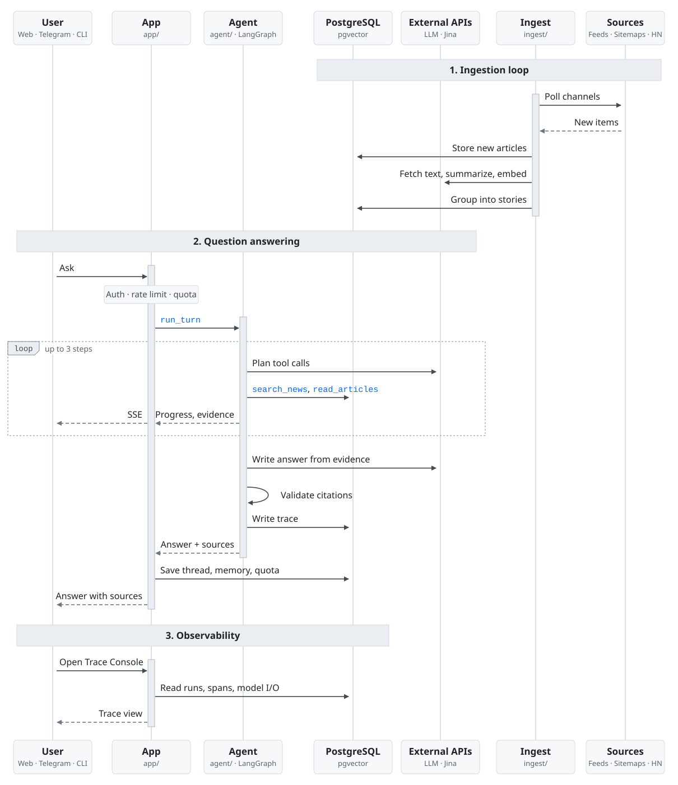

<div align="center">
  <picture>
    <source media="(prefers-color-scheme: dark)" srcset="docs/title-dark.svg">
    
  </picture>
  <br>
  <p align="center">
    <a href="https://agent.trainingcqy.com" style="text-decoration:none"><strong>在线体验</strong></a>
  </p>
</div>

TechNews Intelligence 持续采集中英文科技新闻，并由 Agent 回答关于这些新闻的问题。回答中的事实只来自本轮从库内检索到的文章，正文按编号引用来源，引用由代码校验。

<picture>
  <source media="(prefers-color-scheme: dark)" srcset="docs/architecture-dark.svg">
  
</picture>

## 设计要点

- **采集**：常驻进程轮询官方渠道、中英文科技媒体和 HackerNews，新文章经取正文、模型摘要与分类、生成向量后，按事件归并为故事。
- **检索**：全文、向量、实体别名三路召回，RRF 融合后重排，结果按故事返回。
- **Agent**：LangGraph 编排取证与综合两个模型，工具结果登记为编号证据；回答只能引用登记过的证据，没有有效引用的回答被拦截。
- **记忆**：关注项和阅读记录只决定检索参数，不作为证据。
- **入口**：网页、Telegram Bot、命令行，以及暴露两个工具的 MCP stdio 服务。
- **观测与评测**：每轮问答的执行链路和完整模型输入输出写入 PostgreSQL，在 Trace Console 中查看；评测覆盖采集数据和 Agent 的各层。

## 快速开始

服务器部署：

```bash
git clone https://github.com/Trainingcqy/TechNews_Intelligence.git
cd TechNews_Intelligence
cp .env.example .env                 # 填写模板中的变量，包括注释掉的服务器变量
docker compose up -d postgres
bash scripts/db/apply_schema.sh      # 建表
bash scripts/db/apply_seed.sh        # 导入实体与别名
docker compose up -d
docker compose run --rm ingest python -m ingest sync-sources   # 同步来源，ingest 随后开始轮询
```

本地开发：

```bash
pip install -r requirements.txt -c constraints.txt
pytest tests -q
python -m app.cli
```

本地默认经 SSH 隧道连接服务器上的数据库，环境变量和各入口见[开发与运维](docs/OPERATIONS.md)。

## 文档

- [系统架构](docs/ARCHITECTURE.md)：设计取舍、采集、存储、检索、Agent、交互入口与观测。
- [开发与运维](docs/OPERATIONS.md)：环境变量、本地开发、测试、部署、采集运维、来源维护。
- [评测](docs/EVALUATION.md)：数据层与 Agent 的评测方法和运行步骤。

## License

[AGPL-3.0](LICENSE)
