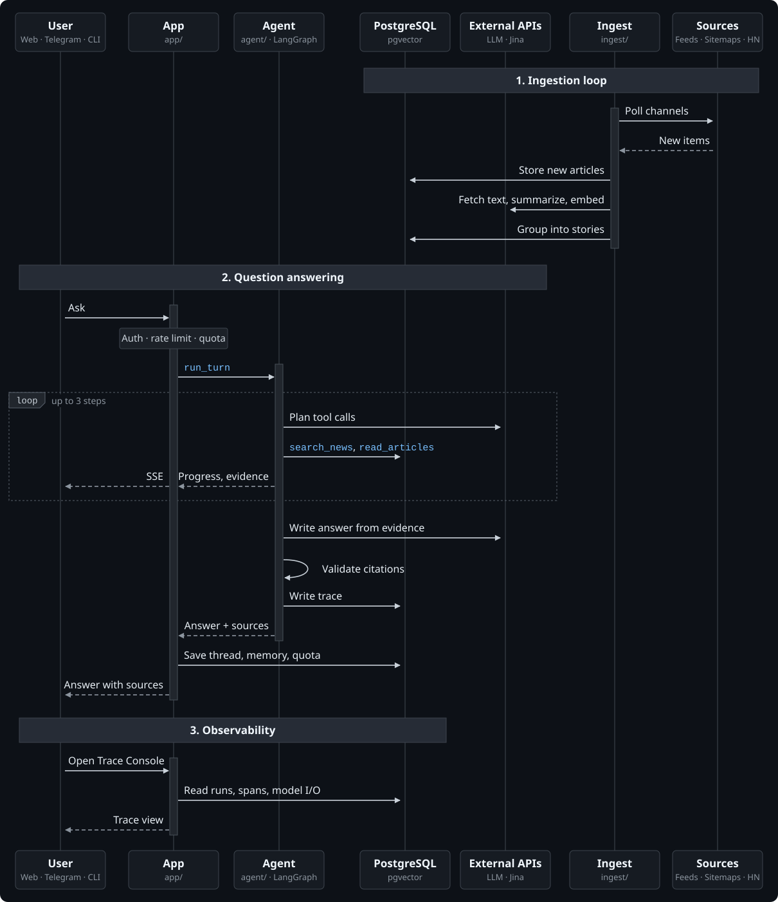

<div align="center">
  
  <br>
  <p align="center">
    <a href="https://dashboard.trainingcqy.com" style="text-decoration:none"><strong>Metabase 演示</strong></a>
    &nbsp;&nbsp; | &nbsp;&nbsp;
    <a href="https://agent.trainingcqy.com" style="text-decoration:none"><strong>智能体交互</strong></a>
  </p>
</div>

TechNews Intelligence 持续采集中英文科技新闻，并由 Agent 回答关于这些新闻的问题。回答中的事实只来自本轮从库内检索到的文章，正文按编号引用来源，引用由代码校验。



## 主要设计

- **采集**：`ingest/` 常驻运行，轮询 14 个官方渠道、17 个中英文科技媒体渠道和 HackerNews 首页。新文章依次经过取正文、模型生成中文标题、摘要与领域和类型标签、生成摘要向量，最后与报道同一事件的文章归并为故事。
- **检索**：全文、向量、实体别名三路召回，RRF 融合后重排，结果按故事返回。
- **Agent**：LangGraph 编排一轮问答。取证模型调用 `search_news`、`read_articles` 两个工具，一步内的多个调用并行执行，取到的材料登记为编号证据。综合模型按编号引用，代码校验引用并生成来源列表，没有有效引用的回答被拦截。
- **记忆**：带入最近几轮对话；用户的关注项和阅读记录只决定检索参数和"此前已提及"标注，不作为证据。
- **入口**：网页（SSE 流式）、Telegram Bot、本地 CLI，以及暴露两个工具的 MCP stdio 服务。
- **观测与评测**：每轮问答的执行链路和完整模型输入输出写入 PostgreSQL，在 Trace Console 中查看。评测覆盖采集数据（分类、故事归并、来源覆盖）和 Agent（检索、忠实度、拒答、验收问题集）。

## 运行

服务器部署：

```bash
git clone https://github.com/Trainingcqy/TechNews_Intelligence.git
cd TechNews_Intelligence
cp .env.example .env                 # 填写模板中的变量，包括注释掉的服务器变量
docker compose up -d postgres
bash scripts/db/apply_schema.sh      # 建表
docker compose up -d
docker compose run --rm ingest python -m ingest sync-sources   # 同步来源，ingest 随后开始轮询
```

本地开发，默认经 SSH 隧道连接服务器上的数据库：

```bash
pip install -r requirements.txt -c constraints.txt
pytest tests -q
python -m app.cli
```

环境变量、部署和运维命令见 [开发与运维](docs/OPERATIONS.md)。

## 目录

| 路径 | 内容 |
| --- | --- |
| `ingest/` | 采集管线 |
| `agent/` | Agent：编排、工具、检索、证据与引用、记忆、Trace、MCP |
| `app/` | Web API、Trace Console 后端、Telegram Bot、CLI |
| `common/` | 共用模块：数据库连接、模型工厂、地址归一、领域与类型词表 |
| `frontend/` | 网页对话前端 |
| `trace_dashboard/` | Trace Console 前端 |
| `eval/` | 评测与验收脚本 |
| `scripts/` | 数据库、冒烟、实体别名和编码检查脚本 |
| `sql/` | 表结构与 seed |
| `tests/` | 单元测试 |

## 文档

- [系统架构](docs/ARCHITECTURE.md)：数据模型、采集状态机、检索、Agent 图、证据与引用、记忆、Trace。
- [开发与运维](docs/OPERATIONS.md)：环境变量、本地开发、测试、部署、采集运维、来源维护。
- [评测](docs/EVALUATION.md)：评测方法、通过条件与运行步骤。

## License

[AGPL-3.0](LICENSE)
