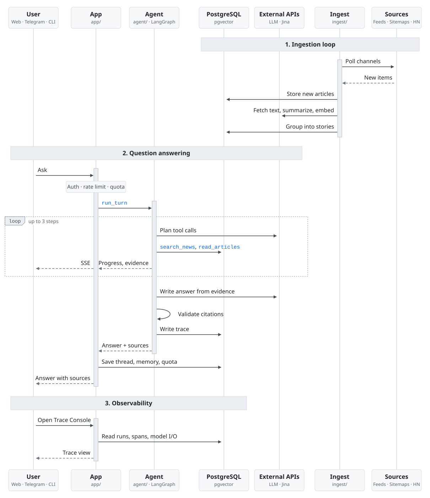

# 系统架构

TechNews Intelligence 由采集管线、存储、检索、Agent、交互入口和 Trace 观测组成。采集管线 `ingest/` 持续写入 PostgreSQL；Agent 只读取数据库，回答中的事实来自本轮检索到的库内文章。Web、Telegram Bot 和命令行经 `agent.run_turn` 调用 Agent，MCP stdio 服务直接暴露两个工具。

<picture>
  <source media="(prefers-color-scheme: dark)" srcset="architecture-dark.svg">
  
</picture>

## 设计取舍

- **代码做确定性计算，模型做判断和表述。** 发现、去重、取正文、故事归并、排序、参数校验和引用校验由代码完成；摘要与分类、选择工具与参数、撰写回答由模型完成。
- **以故事为分析单位。** 报道同一事件的文章归并为一个故事，检索结果、重要性排序和阅读记录都按故事计。
- **发布方、渠道、发现记录分开存。** 文章由谁发布、系统从哪个入口发现它、它在该入口的分数和评论数是三件事，各占一张表。
- **处理状态记在文章表里。** 单进程循环按状态推进各阶段，积压和失败可以直接用 SQL 查询；代价是同一阶段不能由多个进程并发处理。
- **派生数据可重建。** 故事归并和分类标签可以从原始表重算，派生逻辑写在有单测的 Python 中，不写成数据库触发器。
- **摘要统一为中文后生成向量。** 中英文报道落在同一向量空间，跨语言归并不需要额外处理；代价是正文细节不进入向量。
- **向量在时间窗内精确排序，不建近似索引。** 每次检索都带时间窗。IVFFlat 的聚类中心在建索引时固定，数据增长后要定期重建；近似索引的过滤条件在索引扫描之后执行，默认配置下窄过滤时返回的结果少于上限。代价是耗时随时间窗变长而增加，`days=365` 的耗时中位数超过 1 秒时改用近似索引。
- **LangGraph 只做编排。** 图负责一步内多个工具调用的并行执行、按调用序号登记证据，以及显式的节点与路由。不使用 `create_agent`：取证与综合是两个模型，看到的证据视图不同，综合之后还有代码校验，放进 middleware 后控制流不可见。不使用 checkpointer：没有功能需要跨请求暂停和恢复。
- **不设任务分类器。** 工具只有两个，取证模型直接选择工具和参数；问答、盘点、追踪、对照四类任务的区别体现在工具参数和综合模型收到的证据上。
- **链接由代码管理。** 检索结果和证据块只给出证据编号，不给链接；回答的来源列表由代码按编号生成，综合模型输出的地址在引用校验中被删除。取证模型只能经 `urls` 参数读取用户消息中出现过的链接。
- **上限由代码执行。** 步数、单步调用数、累计读取篇数和重复调用都在代码中限制，不依赖提示词。
- **记忆只影响检索参数。** 关注项和阅读记录是结构化的键，决定检索什么、从何时起检索、是否标注"此前已提及"，不进入证据；模型没有写记忆的工具。

系统不做开放的联网研究，用户给出的链接不在库内时，工具返回"该链接不在新闻库内"。综合提示词要求回答不对报道篇数、占比和报道量变化下结论：语料是少数订阅来源，不是普查，这类数字没有外部有效性。

## 采集

采集管线以单进程循环运行，命令为 `python -m ingest loop`，每轮结束后等待 300 秒。Agent 不依赖它的运行状态，`ingest` 停止时已入库的文章照常可以检索。

### 来源

| 角色 | 作用 | 渠道 |
| --- | --- | --- |
| 官方渠道 | 公司和实验室自己的发布，是事件当事方的一手事实 | 14 个，feed 或站点地图 |
| 报道媒体 | 对同一批事件的独立报道 | 17 个，英文 10 个、中文 7 个，feed |
| 社区信号 | HackerNews 首页，指向别处发表的文章，附分数和评论 | 1 个，Algolia 接口 |
| 参照 | Techmeme 的当日头条，只用于验收来源覆盖和重要性排序，不进语料 | 1 个，feed |

发布方和渠道定义在 `ingest/sources.toml`，`python -m ingest sync-sources` 把它同步到数据库。发布方的 `kind` 取 `official`、`media`、`community`、`personal`、`code_host`、`paper_host`、`social`、`unknown` 之一。文章按地址的域名和路径前缀解析发布方，没有命中的域名自动建立发布方。

文章按规范地址去重，规范化由 `common/urls.py` 完成：主机名转小写，去掉 `www.`、默认端口和追踪参数，其余参数按名排序，去掉路径末尾的斜杠。事件时间 `event_at` 取发布时间，没有发布时间时取首次发现时间。

领域与类型是两个封闭词表，定义在 `common/taxonomy.py`。领域 12 个，每篇 1 到 3 个：`ai`、`software`、`chips`、`devices`、`security`、`mobility`、`space_energy`、`internet`、`science`、`business`、`policy`、`general`。类型 9 个，每篇 1 个：`news`、`release`、`research`、`tutorial`、`opinion`、`project`、`discussion`、`promo`、`other`。

### 处理阶段

一篇文章从出现到可检索经过以下阶段，状态记在 `news.article.status`：

```
渠道轮询
  │  候选：地址、标题、发布时间、渠道内标识、分数、feed 自带的正文或摘录
  ▼
discover   地址归一 ─▶ 按地址解析发布方 ─▶ 写 article，状态 discovered ─▶ 写 sighting
  │        同一地址再次出现时只更新 sighting 的分数、评论数、最近出现时间
  │        feed 自带全文的新文章直接写 article_body，状态 fetched，不经过 fetch
  ▼
fetch      调用 Jina Reader
  │        成功：写 article_body，状态 fetched
  │        重试用尽：正文级别保持 excerpt 或 none，状态仍推进到 fetched
  ▼
analyze    一次模型调用，输出中文标题、摘要、领域标签、文章类型；Pydantic 校验
  │        成功：状态 analyzed。重试用尽：状态 failed
  ▼
embed      对摘要生成 1024 维向量，状态 embedded
  ▼
link       在事件时间前后 3 天内找最近邻，相似度不低于 0.85 且并入后故事跨度不超过 7 天时并入其故事，否则新开故事
  │        写 story_member，状态 ready。此后文章可被检索
  ▼
discuss    HackerNews 发现记录满 24 小时后回访一次，取评论写 discussion，并更新分数与评论数
```

| 阶段 | 处理的状态 | 成功后的状态 | 最大尝试次数 | 重试用尽时 |
| --- | --- | --- | --- | --- |
| fetch | `discovered` | `fetched` | 5 | 状态推进到 `fetched`，`body_level` 保持 `excerpt` 或 `none` |
| analyze | `fetched` | `analyzed` | 3 | 状态置为 `failed` |
| embed | `analyzed` | `embedded` | 5 | 状态置为 `failed` |
| link | `embedded` | `ready` | 不限 | 本轮 link 停止，下一轮从出错的那篇重试 |

- 各阶段按首次发现时间升序处理 `next_attempt_at` 已到期的文章，link 按 `event_at` 和 `article_id` 升序。
- 失败时 `attempts` 加一，`error_kind` 记录失败类型，`next_attempt_at` 按 10 分钟、1 小时、6 小时、24 小时的退避表推后，并向 `stage_failure` 追加一行；成功时 `attempts` 清零、`error_kind` 清空。Reader 的失败只按状态码、`Warning:` 响应头和正文长度判定，不看正文内容。
- 取不到正文的文章保留，仍参与故事归并和发布方计数，摘要只依据标题和摘录生成。`python -m ingest requeue` 把 `failed` 的文章恢复到失败前的阶段。
- **discover**：feed 用 `feedparser` 解析，站点地图按路径片段和 `<lastmod>` 过滤，HackerNews 取 Algolia 首页接口；请求带上次保存的 `ETag` 和 `Last-Modified`，渠道连续失败 3 次时向 `ADMIN_EMAIL` 发告警邮件。渠道设了 `body_from_feed` 且 feed 自带的正文不短于 1,500 字符时，新文章直接写入正文；HackerNews 自发帖不经过 Reader，正文不短于 200 字符时直接写入。参照渠道的条目写入 `reference_headline`，不进入后续阶段。
- **fetch**：写入前去掉图片标记，把 Markdown 链接替换为链接文字，去掉 NUL 字符。
- **analyze**：输入是标题、发布方和正文的前 30,000 字符，输出经词表校验，校验失败时在同一次尝试内带着错误信息重发一次。
- **link**：最近邻在时间窗内精确排序，最近邻的编号和相似度无论是否达到阈值都记录。
- **discuss**：取评论树中有正文的顶层评论，按后代评论数降序取前 30 条，每条截取前 800 字符，以原文存储。

### 运行与监控

- 一轮依次执行 discover、fetch、analyze、embed、link、discuss，`loop` 在北京时间每天 9 点之后的第一轮再执行 monitor。任一阶段抛出异常时记录日志并继续下一阶段，未处理的文章留在原状态。
- 整轮持有 PostgreSQL advisory lock，同一时刻只有一个进程处理文章。拿不到锁时，手动执行的 `run` 以退出码 1 结束，`loop` 跳过本轮。
- monitor 计算最近 24 小时的契约指标：领域或类型为空的篇数、摘要含英文双引号的篇数、摘要超长比例、新增可检索文章数、analyze 失败率、正文降级率、连续失败的渠道。其中摘要超长比例、新增可检索文章数、analyze 失败率和正文降级率与此前 14 天的每日中位数比较，基线不足 7 天时不判定。指标越限时向 `ADMIN_EMAIL` 发邮件。

### 故事、讨论与重要性

- **故事**：每篇可检索的文章都属于一个故事，只有一篇报道的文章是只有一个成员的故事。
- **讨论**：HackerNews 发现记录满 24 小时、评论数不低于 20、且发现不超过 7 天时回访一次。不足 24 小时的条目没有讨论文本，工具只给出分数和评论数。
- **重要性**：故事的信号从成员文章聚合得到，包括发布方数、是否含官方发布、HackerNews 最高分与评论数、首次与最近时间。无检索词的浏览依次按发布方数、HackerNews 分数、最近时间降序排序。

## 存储

数据库启用 `vector` 和 `pg_trgm` 扩展。`news` schema 存放采集数据，由 `sql/news.sql` 定义；其余表由 `sql/public.sql` 定义。两个文件都由 `scripts/db/apply_schema.sh` 执行，可以重复执行。

| 表 | 内容 |
| --- | --- |
| `news.publisher`、`news.publisher_host`、`news.channel` | 发布方、域名映射、渠道及其运行状态 |
| `news.article` | 每个规范地址一行：标题、发布时间、中文标题、摘要、领域、类型、正文级别、状态、重试信息；`event_at` 与全文索引列 `search_tsv` 是生成列 |
| `news.article_body` | 正文，来源为 feed、Reader 或 HackerNews |
| `news.article_embedding` | 摘要向量，1024 维 |
| `news.sighting` | 发现记录，按渠道与文章唯一，一篇文章可以出现在多个渠道 |
| `news.discussion` | HackerNews 讨论文本，一条发现记录至多一条 |
| `news.story_member` | 文章所属的故事，以及最近邻文章和相似度 |
| `news.channel_poll`、`news.stage_failure` | 每次轮询的结果；阶段失败记录，只追加 |
| `news.reference_headline` | 参照渠道的头条 |
| `entity_registry`、`entity_alias`、`entity_alias_candidate` | 实体与别名，供精确召回扩展检索词 |
| `access_tokens` | 网页端的访问令牌与额度 |
| `user_follow`、`user_story_seen` | 用户的关注项与阅读记录 |
| `conversation_threads`、`conversation_messages` | 对话线程与消息 |
| `agent_runs`、`agent_trace_spans`、`agent_model_io` | Trace |

实体与别名由 `sql/seed_entities.sql` 和别名候选脚本维护。`agent_model_io` 保存完整的模型输入输出，只经 Trace Console 和受控脚本读取。

## 检索

带检索词的检索由 `agent/retrieval/hybrid.py` 在单条 SQL 内完成三路召回：

- **词法**：`news.article.search_tsv` 上的 Postgres 全文检索，使用 `websearch_to_tsquery` 的 english 与 simple 两种配置，按 `ts_rank_cd` 排序。
- **语义**：`news.article_embedding` 上的 pgvector 余弦距离，没有查询向量时跳过这一路。
- **精确**：用 `entity_alias` 把检索词扩展为别名，在标题和摘要上做 ILIKE 子串匹配和 pg_trgm 三元组相似度匹配，覆盖公司名、产品名等专有名词。

三路各自排名后按带权 RRF 求和，单路得分为 `weight / (60 + rank)`，权重为词法 1.0、语义 1.0、精确 0.7。融合后的候选交给 Jina Reranker 重排，`NEWS_RERANK_MODE=none` 关闭重排，重排失败时保留融合顺序。每次检索都带时间窗。

结果按故事返回：

- 有检索词时，先对文章召回并重排，再按故事去重，每个故事取排名最高的文章作代表，取满 `limit` 个故事为止。
- 没有检索词时，在时间窗和 `topic`、`kind`、`publisher_kind` 限定的文章上按 `sort` 指定的重要性或 HackerNews 分数取前 `limit` 个故事，代表文章依次优先官方发布、有全文、HackerNews 分数高、发布时间早。没有指定类型时只看 `news`、`release`、`research` 三类。
- 每个故事附带统计：报道篇数、发布方数、是否含官方发布、HackerNews 最高分与评论数、首次与最近时间，以及最多 6 篇同故事的其他报道。
- 最相关结果的匹配度低于 0.30 时，返回给取证模型的文本末尾提示结果可能不切题。

## Agent

### 编排

Agent 用 LangGraph 的 `StateGraph` 组织一轮问答，代码在 `agent/graph/`。状态由 `TurnGraphState` 传递；证据登记表、模型句柄和事件回调放在 `TurnRuntime` 中，经 `config["configurable"]["runtime"]` 传给节点。


| 节点 | 并行 | 职责 |
| --- | --- | --- |
| `prepare` | 否 | 构建线程上下文并登记历史来源，读取用户的关注项，组装取证消息 |
| `gather` | 否 | 调用取证模型，对返回的每个工具调用执行 `prepare_call`，发出进度事件 |
| `run_tool` | 是，每个调用一个分支 | 执行 `run_call`，只读取，不写登记表 |
| `collect` | 否 | 按调用序号执行 `commit_call` 登记证据，查询结果中故事的阅读记录，记录命中关注项的检索，发出证据事件 |
| `route` | 否 | 按代码规则决定直接回复、未找到或进入综合 |
| `synthesize` | 否 | 调用综合模型 |
| `finalize` | 否 | 解析状态、校验并重编号引用、生成来源列表 |

执行规则：

- **取证循环**：每步最多处理 4 个工具调用，超出的调用记为被拒绝，照常返回 `ToolMessage`；最多 3 步，由 `AGENT_MAX_STEPS` 设置，取值 1 到 6；一次请求累计读取至多 8 篇。步数用尽时 `gather` 不再调用模型，直接进入 `route`。
- **并行**：一步内的多个调用由 `Send` 分发到 `run_tool` 分支并行执行。证据只在 `collect` 中按调用序号登记，编号顺序与分支的完成顺序无关；事件只由 `prepare`、`gather`、`collect`、`synthesize` 四个串行节点发出。
- **路由**：取证模型一次工具都没有调用时，回答为 `direct`，文本取模型的直接回复；调用过工具但登记表中没有可引用证据时，回答为 `not_found`；否则进入综合。调用过工具之后，取证模型的文本回复被忽略。
- **综合与收尾**：综合模型看到接地规则、线程上下文、问题和证据块，首行输出 `STATUS: answered` 或 `STATUS: insufficient`，正文用 `[E3]` 形式的编号引用证据。收尾时校验引用并重编号为 `[1]`、`[2]`，生成来源列表；状态为 `answered` 而没有任何有效引用时，回答为 `blocked`。

| `Answer.status` | 含义 | 来源 | 计额度 |
| --- | --- | --- | --- |
| `answered` | 依据证据的回答 | 有 | 计 |
| `insufficient` | 检索到材料但不足以回答，模型如实说明 | 可有可无 | 不计 |
| `direct` | 没有调用工具的直接回复 | 无 | 不计 |
| `not_found` | 调用了工具但没有可引用的材料 | 无 | 不计 |
| `blocked` | 模型给出回答但没有任何有效引用，被拦截 | 无 | 不计 |
| `error` | 模型调用失败或运行时异常 | 无 | 不计 |

取证模型决定调用哪个工具、填什么参数，不撰写最终回答，须支持工具调用；综合模型依据证据块撰写回答，评测的判官默认也用它。默认由 DeepSeek 取证、Vertex AI 上的 Gemini 综合，供应商与模型由 `AGENT_GATHER_*`、`AGENT_FINAL_*` 设置，取值见[开发与运维](OPERATIONS.md)。

运行边界：

- LangGraph 只出现在 `agent/graph/`。检索、工具、证据登记表、引用校验都是普通模块，可以脱离图单独测试。
- 工具参数只经 Pydantic 校验，错误文本返回给取证模型，模型可在剩余步数内修正。
- 经 `urls` 参数读取只能针对用户消息或历史用户消息中出现过的链接；MCP 入口不做这项限制，只校验链接在库内。

### 工具

| 工具 | 用途 |
| --- | --- |
| `search_news` | 在新闻库中查找报道，结果按故事归并。有具体对象时填 `query`；没有具体对象时用 `topic`、`kind`、`publisher_kind` 和时间窗限定范围。时间窗用 `days`，或用 `start_date`、`end_date` 指定过去的某一时段。有 `query` 时 `sort` 取 `relevance` 或 `time`，没有时取 `importance` 或 `hn` |
| `read_articles` | 读取正文。`ids` 填检索结果里的证据编号，文章和 HackerNews 讨论都可以读；`urls` 只能填用户消息中出现过的链接。`max_chars` 默认 4,000 |

盘点、追踪、对照都由取证模型组合这两个工具的参数完成。一次工具调用分三个阶段：

| 阶段 | 函数 | 所在节点 | 内容 |
| --- | --- | --- | --- |
| 准备 | `prepare_call` | `gather` | 依次检查工具名、是否与之前的调用完全相同、参数、读取额度；不通过时返回 `ok=False` 的结果，文本交给取证模型。额度只够读一部分目标时，截掉的目标作为读取失败项返回 |
| 执行 | `run_call` | `run_tool`，并行 | 查库、重排、取正文，在 `tool` span 内执行，处理函数抛出的异常转成 `ok=False` 的结果 |
| 提交 | `commit_call` | `collect` | 登记证据，生成返回给取证模型的文本 |

`search_news` 的参数组合有校验：`relevance` 要求有 `query`，`importance` 和 `hn` 要求没有 `query`；`sort` 为空时，有 `query` 取 `relevance`，没有取 `importance`；`end_date` 不能单独填写，`start_date` 不能晚于 `end_date`。

### 证据与引用

`agent/evidence.py` 的 `EvidenceRegistry` 记录本轮出现过的全部材料。一次 `run_turn` 一个实例，跨轮稳定的标识是地址。

- **编号**：按首次登记的顺序分配 `E1`、`E2`。同一份材料按文档类别加 `url_key` 判定，重复登记时复用原编号；HackerNews 自发帖的文章与讨论页地址相同，按类别区分，各有一个编号。
- **级别只升不降**：`listed` 只列出，`summary` 有摘要，`fulltext` 有正文。只有 `summary` 和 `fulltext` 的证据可以被引用。
- **写入只发生在串行节点**：登记和升级只由 `prepare` 和 `collect` 执行，并行分支只读。
- **阅读记录标注**：用户有标识时，`collect` 把本步结果中的故事此前出现在该用户回答里的日期写入 `seen_dates`。带统计行的证据在行末追加"此前已在 MM-DD 的回答中提及"，综合提示词要求这类故事只简要带过，除非有新进展。

`search_news` 的提交按结果顺序登记：每个故事的代表文章以 `summary` 级别登记并附带故事统计，同故事的其他报道和入库的讨论以 `listed` 级别登记。`read_articles` 读到正文后把证据升为 `fulltext`，被读取的讨论和只列出的报道由此成为可引用证据。

综合模型的证据块包含标题、中文标题、发布方及其角色、时间、领域、类型、故事统计行、摘要，以及正文或评论节选，没有入库正文的文章会标明。证据块超过 60,000 字符时，从最后登记的 `fulltext` 证据开始去掉正文、退回摘要。

`agent/citations.py` 解析并校验综合输出：读取首行的 `STATUS`，删除模型自带的数字引用和正文中的原始地址，把 `[E1, E2]` 展开为 `[E1][E2]`，把可引用的编号按首次出现的顺序映射为 `[1]`、`[2]`，删除不在可引用集合中的编号，最后生成来源列表和被引用来源所属的故事编号，后者用于写入阅读记录。

| 条件 | 结果 |
| --- | --- |
| 模型输出为空 | `error`，`error_code` 为 `empty_synthesis` |
| 状态为 `insufficient` | `insufficient`，不要求有引用 |
| 状态为 `answered` 或缺失，且有至少一个有效引用 | `answered` |
| 状态为 `answered` 或缺失，且没有有效引用 | `blocked`，`error_code` 为 `no_valid_citation` |

未找到、被拦截、出错时的固定文案和寒暄的备用回复按问题是否含中文选择中文或英文。

### 上下文与记忆

| 类别 | 内容 | 存储 |
| --- | --- | --- |
| 工作记忆 | 线程内最近几轮对话和上一轮的来源 | 不新增表，`agent/context.py` 在请求内构建 |
| 情景记忆 | 用户在哪天的回答里看过哪些故事 | `public.user_story_seen` |
| 语义记忆 | 用户长期关注的对象 | `public.user_follow` |

**线程上下文**：历史消息由渠道层持久化，模型消息带回答状态和来源列表。构建时取最后 `AGENT_HISTORY_TURNS` 轮，默认 4 轮，一轮是一条用户消息加紧随其后的一条模型消息。

1. 这些轮次中全部来源的地址一次查出，以 `summary` 级别登记到本轮的证据登记表；HackerNews 讨论页的来源不重新登记。历史来源因此可以直接按编号读取，综合阶段也可以引用。
2. 模型消息去掉来源小节，历史中的 `[n]` 换成本轮登记表中的 `[E…]`，找不到对应来源的标记删除，再截取前 1,500 字符。
3. 历史用户消息中出现过的地址记入 `user_urls`，供 `read_articles` 校验链接来源。
4. 数据库查询失败时跳过登记，消息照常返回。

追问中的指代，例如"第二条详细说说""那家公司后来呢"，由取证模型在填写工具参数时消解。线程上下文只按轮数截断，不做长会话摘要。本轮没有调用工具时回答仍是 `direct`，历史来源只在本轮调用了工具时才进入综合。

**用户记忆**：Web 的用户标识是 `email:` 加访问令牌对应的邮箱，Telegram 是 `tg:` 加 chat id；CLI 和 MCP 没有用户标识，不启用记忆。每个用户的有效关注项至多 20 个，删除只把 `active` 置为假，同一检索词忽略大小写再次添加时恢复原行。

- **写入**：回答为 `answered` 时，渠道层调用 `record_turn`，把被引用来源所属的故事写入 `user_story_seen`，并把本轮命中的关注项的查看时间更新为当前时间。执行成功的 `search_news` 的 `query` 与某个关注项忽略大小写后相等即为命中，零结果的检索同样计入。
- **读取**：`prepare` 把全部有效关注项渲染进取证提示词，每项列出上次查看的日期和距今天数。用户问"我关注的有什么新进展"一类问题时，提示词要求对每个关注项各发一次 `search_news`，`days` 填距上次查看的天数，最少 1，尚未查看过的填 14，最多 30。`collect` 查出本步结果中的故事此前出现在该用户回答里的日期，供证据标注。
- **失败处理**：记忆查询失败时按没有记忆处理，不让整轮对话失败。

## 交互入口

| 入口 | 实现 | 说明 |
| --- | --- | --- |
| Web/API | `app/api.py`、`web/chat/` | 令牌校验、限流、额度和对话线程；`/chat` 同步返回，`/chat-stream` 以 SSE 推送 `progress`、`evidence` 事件和最终的 `final`；`/follows` 管理关注项 |
| Trace Console | `app/trace_api.py`、`web/trace/` | 管理员令牌访问的链路追踪面板 |
| Telegram Bot | `app/bot.py` | 按 chat id 维护会话，`/follow`、`/unfollow`、`/follows` 命令管理关注项 |
| CLI | `app/cli.py` | 本地命令行，在进程内维护对话历史 |
| MCP | `agent/mcp/stdio_server.py` | stdio 服务，暴露 `search_news`、`read_articles` 和资源 `news://corpus`；每次调用新建登记表，返回中带证据的地址 |

渠道层负责鉴权、额度、持久化和渲染，不解析回答文本。只有 `answered` 计额度，其余状态退还；状态为 `error` 的一轮不写入对话历史。关注项只经 Web 的 `/follows` 接口、网页聊天头部的关注列表和 Telegram 命令增删。

## 观测

Trace 记录一次 `run_turn` 的过程，代码在 `agent/trace.py`，写入 PostgreSQL 的三张表：

| 表 | 内容 |
| --- | --- |
| `agent_runs` | 每次请求一行：问题、渠道、线程、状态、耗时、token、警告，以及路由、引用校验、回答、证据表 |
| `agent_trace_spans` | 每个 span 一行：类型、父 span、起止时间、输入、输出、属性、警告、错误与回溯 |
| `agent_model_io` | 每次模型调用的完整输入消息与原始输出 |

span 按一轮问答的语义单位组织，请求行是树的根：

| 类型 | 含义 |
| --- | --- |
| `context` | 准备上下文：带入的历史轮数、由历史来源登记的证据、关注项 |
| `step` | 取证的一步：一次取证模型调用，以及由它引发的工具执行与证据登记；记录模型提出的每个调用及其处置，拒绝时附原因 |
| `llm` | 一次模型调用，名称为 `gather` 或 `final`：供应商、模型、结束原因、token |
| `tool` | 一次工具执行，名称为工具名：参数、命中的故事或各篇的读取结果、返回给取证模型的文本 |
| `embedding`、`retrieval`、`rerank` | 带检索词的 `search_news` 内部的向量化、召回与重排；召回与重排记录候选的文章编号和分数 |

- 路由与引用校验没有耗时，记在请求行的输出里。证据表列出本轮登记的每个证据编号，以及它登记、升级于哪一步的哪个调用，证据块中是否带正文，被引用为第几条。
- 一步跨 `gather`、`run_tool`、`collect` 三个节点。LangGraph 在复制的上下文中执行节点，跨节点的 span 不能经 ContextVar 传递，`step` 由 `TurnRuntime` 持有；同一步的工具调用都以它为父 span。
- token 按 OpenTelemetry GenAI 语义约定记五项：输入含缓存命中，输出含推理，另记缓存命中数、推理数和总数；请求级按模型汇总。
- 降级记为警告，例如达到步数上限、调用被拒绝、重排回退、未取得查询向量、证据块去掉了正文、引用校验删除了编号，汇总到请求行。
- 请求开始时写入状态为 `running` 的请求行，结束时在一个事务内补全请求行并写入 span 与模型输入输出，写入失败只记日志。模型输入输出中疑似凭据的内容按正则替换。
- MCP 的工具调用不经过 `run_turn`，不进 Trace。

Trace Console 读取这些表。左栏是请求列表，可按状态、渠道筛选，评测请求默认不列出；中栏是 span 树与时间轴，同一步并行的工具调用条形重叠。取证模型没有提出调用的那次调用单独成行，显示为“结束取证”或“直接回复”，不计入步数，与验收脚本的口径一致。警告标在它所涉及的行上：请求级的达到步数上限标在最后一步，证据块去掉正文与引用校验删除标在综合模型。右栏是选中行的详情：请求行先列出各条警告及其位置和含义，再给出回答、证据表、路由与引用校验；取证的一步给出模型提出的调用及处置，模型调用按需加载完整的输入输出，检索给出候选在召回与重排中的名次。点击线程按顺序列出同一会话的各轮。`eval/trace_query.py --node-stats` 按节点统计耗时和 token 的中位数，以及一步内多个调用并行执行的收益。

LangSmith 是可选的外部观测，由 `LANGSMITH_*` 和 `LANGCHAIN_*` 环境变量启用，与自研 Trace 互不依赖。

## 目录结构

| 路径 | 内容 |
| --- | --- |
| `ingest/` | 采集管线 |
| `agent/` | Agent：编排、工具、检索、证据与引用、记忆、Trace、MCP |
| `app/` | Web API、Trace Console 后端、Telegram Bot、CLI |
| `common/` | 共用模块：数据库连接、模型工厂、地址归一、领域与类型词表 |
| `web/chat/` | 网页对话前端 |
| `web/trace/` | Trace Console 前端 |
| `eval/` | 评测与验收脚本 |
| `scripts/` | 数据库、冒烟、实体别名和编码检查脚本 |
| `sql/` | 表结构与 seed |
| `tests/` | 单元测试 |
