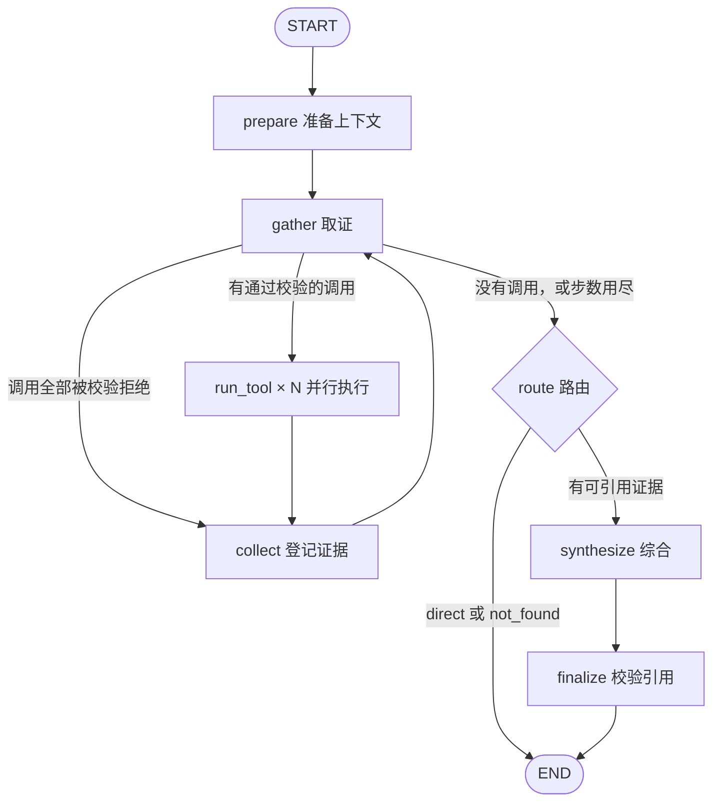

# 系统架构

TechNews Intelligence 由采集管线、存储层、Agent 运行时、交互入口、Trace 观测和离线评测组成。采集管线 `ingest/` 持续写入 PostgreSQL，Agent 只读取数据库，回答中的事实来自本轮检索到的库内文章。Web/API、Telegram Bot 和本地 CLI 通过 `agent.run_turn` 调用 Agent；MCP stdio 服务直接暴露两个工具；评测脚本按评测对象分别调用 `run_turn`、检索函数或模型层。

## 总览

<picture>
  <source media="(prefers-color-scheme: dark)" srcset="architecture-dark.svg">
  
</picture>

## 数据采集链路

采集管线是仓库内的 Python 包 `ingest/`，以单进程循环运行，命令为 `python -m ingest loop`，每轮结束后等待 300 秒再开始下一轮。实时 Agent 不依赖它的运行状态：`ingest` 停止时，已入库的文章照常可以检索，只是不再增加。

### 来源

来源按在任务中的角色选取：

| 角色 | 作用 | 渠道 |
| --- | --- | --- |
| 官方渠道 | 事件的当事方：公司和实验室自己的发布，是一手事实 | 14 个，feed 或站点地图 |
| 报道媒体 | 对同一批事件的独立报道 | 17 个，其中英文 10 个、中文 7 个，feed |
| 社区信号 | HackerNews 首页：指向别处发表的文章，附分数和评论 | 1 个，Algolia 接口 |
| 参照 | Techmeme 的当日头条，只用于验收来源覆盖和重要性排序，不进语料 | 1 个，feed |

发布方和渠道定义在 `ingest/sources.toml`，它是唯一真源。`python -m ingest sync-sources` 把它同步到 `news.publisher`、`news.publisher_host` 和 `news.channel`；库中另外保存渠道的运行状态，同步不改动这些列。停用渠道时在文件中写 `enabled = false`，已有的发现记录保留；`google_ai_blog`、`aws_ml_blog`、`nvidia_dev_blog` 三个渠道处于停用状态。

发布方的 `kind` 取值为 `official`、`media`、`community`、`personal`、`code_host`、`paper_host`、`social`、`unknown`。文章按地址的域名和路径前缀解析发布方；没有命中的域名自动建立发布方。

### 数据模型

数据分三层：

- **发布方**（`publisher`、`publisher_host`）：文章是谁写的，按域名或域名加路径前缀识别，角色挂在发布方上。
- **渠道**（`channel`）：系统轮询的入口。一个发布方可以有多个渠道，聚合类渠道不属于任何发布方。
- **发现记录**（`sighting`）：某篇文章在某个渠道出现的时间、渠道内标识、分数和评论数。一篇文章可以有多条发现记录，例如一篇官方公告既出现在官方渠道，又被转到 HackerNews 首页。

`news` schema 中的表：

| 表 | 内容 |
| --- | --- |
| `publisher`、`publisher_host`、`channel` | 发布方、域名映射、渠道及其运行状态 |
| `article` | 每个规范地址一行：标题、发布时间、中文标题、摘要、领域 `topics`、类型 `kind`、正文级别 `body_level`、状态、重试信息。`event_at` 与全文索引 `search_tsv` 是生成列 |
| `article_body` | 正文，来源为 `feed`、`reader` 或 `hn` |
| `article_embedding` | 摘要向量，1024 维，不建近似索引 |
| `sighting` | 发现记录，按 `(channel_id, article_id)` 唯一 |
| `discussion` | HackerNews 讨论文本，一条发现记录至多一条 |
| `story_member` | 文章所属的故事，派生数据，可重建；记录最近邻的文章和相似度 |
| `channel_poll`、`stage_failure` | 每次轮询的结果；阶段失败记录，只追加 |
| `reference_headline` | 参照渠道的头条，不进语料 |

- `article.url_key` 是文章去重的键，由 `common/urls.py` 的 `url_key` 生成：主机名转小写并去掉 `www.` 和默认端口，去掉 `utm_` 开头的参数和 `fbclid` 等追踪参数，其余参数按名排序，去掉路径末尾的斜杠。
- `event_at` 取发布时间，没有发布时间时取首次发现时间。HackerNews 的候选不带发布时间，按首次发现时间计。
- 领域与类型是两个封闭词表，定义在 `common/taxonomy.py`，版本 1。领域 12 个：`ai`、`software`、`chips`、`devices`、`security`、`mobility`、`space_energy`、`internet`、`science`、`business`、`policy`、`general`，一篇文章 1 到 3 个。类型 9 个：`news`、`release`、`research`、`tutorial`、`opinion`、`project`、`discussion`、`promo`、`other`，一篇文章 1 个。没有指定类型、也没有检索词的浏览只看 `news`、`release`、`research` 三类。

### 处理阶段与状态机

一篇文章从出现到可检索经过六个阶段，状态记在 `news.article.status`。

```
渠道轮询
  │  候选：地址、标题、发布时间、渠道内标识、分数、feed 自带的正文或摘录
  ▼
discover   地址归一 ─▶ 按地址解析发布方 ─▶ 写 article，状态 discovered ─▶ 写 sighting
  │        同一地址再次出现时只更新 sighting 的分数、评论数、最近出现时间
  │        feed 自带全文的新文章直接写 article_body，状态 fetched，不经过 fetch
  ▼
fetch      调用 Jina Reader
  │        成功：写 article_body，状态 fetched
  │        重试用尽：正文级别保持 excerpt 或 none，状态仍推进到 fetched
  ▼
analyze    一次模型调用，输出中文标题、摘要、领域标签、文章类型；Pydantic 校验
  │        成功：状态 analyzed。重试用尽：状态 failed
  ▼
embed      对摘要生成 1024 维向量，状态 embedded
  ▼
link       在事件时间前后 3 天内找最近邻，相似度不低于 0.85 且并入后故事跨度不超过 7 天时并入其故事，否则新开故事
  │        写 story_member，状态 ready。此后文章可被检索
  ▼
discuss    HackerNews 发现记录满 24 小时后回访一次，取评论写 discussion，并更新分数与评论数
```

| 阶段 | 处理的状态 | 成功后的状态 | 最大尝试次数 | 重试用尽时 |
| --- | --- | --- | --- | --- |
| fetch | `discovered` | `fetched` | 5 | 状态推进到 `fetched`，`body_level` 保持 `excerpt` 或 `none` |
| analyze | `fetched` | `analyzed` | 3 | 状态置为 `failed` |
| embed | `analyzed` | `embedded` | 5 | 状态置为 `failed` |
| link | `embedded` | `ready` | 不限 | 本轮 link 停止，下一轮从出错的那篇重试 |

- 每个阶段取 `next_attempt_at` 已到期的文章，按首次发现时间升序处理；link 按 `event_at`、`article_id` 升序。
- 失败时 `attempts` 加一，`error_kind` 记录失败类型，`next_attempt_at` 按 10 分钟、1 小时、6 小时、24 小时的退避表推后，超出表长时取最后一项，并向 `stage_failure` 追加一行。成功时 `attempts` 清零、`error_kind` 清空。
- 失败类型：`reader_http`、`reader_blocked`、`reader_empty`（fetch）；`timeout`、`network`（fetch、analyze、embed）；`llm_http`、`invalid_json`、`schema_violation`（analyze）；`embed_http`、`embed_shape`（embed）；`unexpected`（以上之外的异常）。Reader 的失败只按状态码、`Warning:` 响应头和正文长度判定，不看正文内容。
- 取不到正文的文章保留，仍参与故事归并和发布方计数，摘要只依据标题和摘录生成。
- `python -m ingest requeue --status failed [--error-kind <类型>]` 把 `failed` 的文章恢复到失败前的阶段。

各阶段的要点：

- **discover**：feed 用 `feedparser` 解析，站点地图按路径片段和 `<lastmod>` 过滤，HackerNews 取 Algolia 首页接口。渠道设了 `body_from_feed` 且 feed 自带的正文不短于 1,500 字符时，新文章入库时直接写入正文并置为 `fetched`；HackerNews 自发帖的地址指向评论页，不经过 Reader，正文不短于 200 字符时直接写入。渠道 `config` 可设 `body_from_feed`、`lookback_days`（默认 3 天）、`url_pattern`、`max_path_segments`、`discussion_after_hours`、`discussion_min_comments`。请求带上次保存的 `ETag` 和 `Last-Modified`。渠道连续失败 3 次时向 `ADMIN_EMAIL` 发告警邮件。参照渠道走同一套轮询，条目写入 `reference_headline`，不进入后续阶段。
- **fetch**：经 Jina Reader 获取正文，写入前去掉图片标记，把 Markdown 链接替换为链接文字，并去掉 NUL 字符。
- **analyze**：输入是标题、发布方和正文的前 30,000 字符，默认模型为 `deepseek-flash`，输出经 `common/taxonomy.py` 的词表校验。校验失败时在同一次尝试内带着错误信息重发一次。
- **embed**：模型 `jina-embeddings-v3`，输入为中文摘要，所有摘要都是中文，中英文报道因此落在同一向量空间。
- **link**：最近邻在时间窗内精确排序，不经过向量索引。故事是单一事件，跨度上限在代码里执行；最近邻的编号和相似度无论是否达到阈值都记录。
- **discuss**：取评论树中有正文的顶层评论，按后代评论数降序取前 30 条，每条截取前 800 字符，以原文存储，不由模型总结。

### 运行与监控

- 一轮依次执行 discover、fetch、analyze、embed、link、discuss，`loop` 在北京时间每天 9 点之后的第一轮再执行 monitor。任一阶段抛出异常时记录日志并继续下一阶段，未处理的文章留在原状态。
- 整轮持有 PostgreSQL advisory lock（键 `0x6E657773`），同一时刻只有一个进程处理文章。拿不到锁时，手动执行的 `run` 以退出码 1 结束，`loop` 跳过本轮。
- 各阶段的并发、每轮上限、请求超时、重试上限和分析模型是 `IngestConfig` 的字段，环境变量为 `INGEST_` 加字段名大写。
- monitor 计算最近 24 小时的契约指标：领域或类型为空的篇数、摘要含英文双引号的篇数、摘要超长比例、新增可检索文章数、analyze 失败率、正文降级率、连续失败的渠道。其中摘要超长比例、新增可检索文章数、analyze 失败率、正文降级率四项与此前 14 天的每日中位数比较，基线不足 7 天时不判定。越限时向 `ADMIN_EMAIL` 发邮件。
- 管理命令见 [开发与运维](OPERATIONS.md) 的「采集运维」。

### 故事、讨论与重要性

- **故事**：多篇文章报道同一事件时归为一个故事（`story_member.story_id`）。每篇可检索的文章都属于某个故事，只有一篇报道的文章是只有一个成员的故事。
- **讨论**：HackerNews 发现记录满 24 小时、评论数不低于 20、且发现不超过 7 天时回访一次；发现不足 24 小时的条目没有讨论文本，工具只给出分数和评论数。
- **重要性**：故事的信号从成员文章聚合得到：发布方数、是否含官方发布、HackerNews 最高分与评论数、首次与最近时间。无检索词的浏览按发布方数降序、HackerNews 分数降序、最近时间降序排序。

### 数据库与数据层约定

数据库启用 `vector` 和 `pg_trgm` 扩展。`news` schema 由 `sql/news.sql` 管理，其余表由 `sql/public.sql` 管理，两者都由 `scripts/db/apply_schema.sh` 执行。

`public` schema 中的表：

| 领域 | 表 |
| --- | --- |
| 实体 | `entity_registry`, `entity_alias`, `entity_alias_candidate` |
| 访问 | `access_tokens` |
| 用户记忆 | `user_follow`, `user_story_seen` |
| 对话 | `conversation_threads`, `conversation_messages` |
| Trace | `agent_runs`, `agent_trace_spans`, `agent_model_io` |

数据层约定：

- 检索的精确召回路用 `entity_registry`、`entity_alias` 把查询扩展为别名词项，这两张表由 `sql/seed_entities.sql` 和别名候选脚本维护。
- 向量检索只作为候选召回来源，最终回答仍须经证据登记表和引用校验。
- `agent_model_io` 可能包含完整模型输入输出，只通过 Trace Console 和受控脚本读取，不作为常规业务接口返回。

## Agent Graph

Agent 使用 LangGraph 的 `StateGraph` 组织一次问答（`agent/graph/`），不使用 `create_agent`，也不使用 checkpointer。图由取证循环、路由、综合和收尾组成，状态由 `TurnGraphState` 传递；登记表、模型句柄和事件回调放在 `TurnRuntime` 中，经 `config["configurable"]["runtime"]` 传给节点。问答、盘点、追踪、对照四类任务走同一张图，区别在取证模型发出的工具参数，不设任务分类器。



| 节点 | 并行 | 职责 |
| --- | --- | --- |
| `prepare` | 否 | 构建线程上下文并登记历史来源；记录当前问题和历史中出现过的地址；读取用户的关注项；组装取证消息序列 |
| `gather` | 否 | 调用取证模型；对返回的工具调用逐个执行 `prepare_call`；发出进度事件 |
| `run_tool` | 是，每个调用一个分支 | 执行 `run_call`，只读取，不写登记表，不发事件 |
| `collect` | 否 | 查询本步检索结果中的故事的阅读记录；按调用序号对结果执行 `commit_call`，登记证据并追加 `ToolMessage`；记录命中关注项的检索；发出证据事件；步数加一 |
| `route` | 否 | 按代码规则决定直接回复、未找到或进入综合 |
| `synthesize` | 否 | 调用综合模型 |
| `finalize` | 否 | 解析状态、校验并重编号引用、生成来源列表 |

执行规则：

- **取证循环**：每步最多处理 4 个工具调用（`max_calls_per_step`），超出的调用记为被拒绝，其 `ToolMessage` 仍然返回；最多 3 步（`AGENT_MAX_STEPS`，取值 1 到 6）；一次请求累计读取至多 8 篇（`max_read_articles`）。步数用尽时 `gather` 不再调用模型，直接进入 `route`。
- **并行**：一步内的多个检索由 `Send` 分发到 `run_tool` 分支并行执行。证据只在单线程的 `collect` 中按调用序号登记，编号顺序与分支的完成顺序无关；事件只由 `prepare`、`gather`、`collect`、`synthesize` 四个串行节点发出。
- **路由**：取证模型一次工具都没有调用时，回答为 `direct`，文本取模型的直接回复；调用过工具但登记表中没有可引用证据时，回答为 `not_found`；否则进入综合。调用过工具之后取证模型的文本回复被忽略。
- **综合**：综合模型看到接地规则、线程上下文、问题和证据块，输出首行 `STATUS: answered` 或 `STATUS: insufficient`，正文用 `[E3]` 形式的证据编号引用。
- **收尾**：校验引用并重编号为 `[1]`、`[2]`……，生成来源列表。状态为 `answered` 而没有任何有效引用时，回答为 `blocked`。

回答状态：

| `Answer.status` | 含义 | 是否有来源 | 是否计额度 |
| --- | --- | --- | --- |
| `answered` | 依据证据的回答 | 有 | 计 |
| `insufficient` | 检索到材料但不足以回答，模型如实说明 | 可有可无 | 不计 |
| `direct` | 没有调用工具的直接回复 | 无 | 不计 |
| `not_found` | 调用了工具但没有可引用的材料 | 无 | 不计 |
| `blocked` | 模型给出回答但没有任何有效引用，被拦截 | 无 | 不计 |
| `error` | 模型调用失败或运行时异常 | 无 | 不计 |

模型角色：

| 角色 | 职责 | 默认提供方与模型 | 变量 |
| --- | --- | --- | --- |
| gather | 取证：决定调用哪个工具、什么参数，不撰写最终回答 | DeepSeek，`deepseek-flash` | `AGENT_GATHER_PROVIDER`、`AGENT_GATHER_MODEL` |
| final | 综合：依据证据块撰写回答；评测的判官也使用它 | Vertex AI，`gemini-3.1-pro-preview` | `AGENT_FINAL_PROVIDER`、`AGENT_FINAL_MODEL` |

供应商只认 `gemini_api`、`vertex`、`deepseek` 三个名字，模型经 `common/llm_provider.py` 构建。取证模型须支持工具调用。

运行边界：

- LangGraph 只出现在 `agent/graph/`。检索、工具、证据登记表、引用校验都是普通模块，可以脱离图单独测试。
- 工具参数只有 Pydantic 这一层校验，错误文本返回给取证模型，模型可在剩余步数内修正。
- 回答中的来源只能来自证据登记表：综合模型输出的原始地址和未登记的编号在引用校验中被删除。
- 经 `urls` 参数读取只能针对用户消息或历史用户消息中出现过的链接；MCP 入口不做这项限制，只校验链接在库内。

## 上下文记忆

记忆分三类：

| 类别 | 内容 | 存储 |
| --- | --- | --- |
| 工作记忆 | 线程内最近几轮对话和上一轮的来源 | 不新增表，`agent/context.py` 在请求内构建 |
| 情景记忆 | 用户在哪天的回答里看过哪些故事 | `public.user_story_seen` |
| 语义记忆 | 用户长期关注的对象 | `public.user_follow` |

### 线程上下文

线程上下文由 `agent/context.py` 在请求内构建，不写入任何摘要。

历史消息由渠道层持久化，格式为：

```python
{"role": "user",  "parts": [{"text": "..."}]}
{"role": "model", "parts": [{"text": "正文，引用形如 [1]"}], "status": "answered",
 "sources": [{"n": 1, "url": "...", "title": "...", "title_zh": "...", "source": "...", "published_at": "2026-11-12"}]}
```

构建步骤：

1. 取最后 `AGENT_HISTORY_TURNS` 轮（默认 4），一轮是一条用户消息加紧随其后的一条模型消息。
2. 这些轮次中所有来源的地址经 `fetch_articles_by_url_keys` 一次查出，以 `summary` 级别登记到本轮的证据登记表；HackerNews 讨论页的来源不重新登记。历史轮次的来源因此可以直接用编号读取，综合阶段也可以引用。
3. 模型消息的正文去掉来源小节，历史中的 `[n]` 换成本轮登记表中的 `[E…]`，找不到对应来源的标记删除，再截取前 1,500 字符。
4. 消息没有 `sources` 而有 `citation_urls` 字段时，按 `citation_urls` 的顺序对应 `[n]`。
5. 历史用户消息中出现过的地址记入 `user_urls`，供 `read_articles` 校验链接来源。
6. 数据库查询失败时跳过登记，消息照常返回。

追问中的指代，例如"第二条详细说说""那家公司后来呢"，由取证模型根据对话上下文在填写工具参数时消解。线程上下文只按轮数截断，不做长会话摘要。历史中已有证据但本轮没有调用工具时，回答仍是 `direct`：历史来源只在本轮调用了工具时才进入综合。

### 用户记忆

**约束**：记忆只决定检索参数，不进入证据块。关注项决定检索什么、从何时检索起；阅读记录决定一个故事是否标为"此前已提及"。回答中的事实只能来自本轮检索到的库内文章。模型没有写记忆的工具，关注项只经渠道层的显式入口增删，见"交互入口"。

**用户标识** `user_key`：Web 取 `email:` 加访问令牌对应的邮箱，Telegram 取 `tg:` 加 chat id。CLI 和 MCP 没有用户标识，不启用记忆：`run_turn` 的 `user_key` 为空时，`prepare` 与 `collect` 不读取记忆。

**存储**：表定义在 `sql/public.sql`。

| 表 | 字段 | 约束 |
| --- | --- | --- |
| `public.user_follow` | `follow_id`、`user_key`、`query`、`active`、`created_at`、`last_checked_at` | `(user_key, LOWER(query))` 唯一 |
| `public.user_story_seen` | `user_key`、`story_id`、`first_seen_at`、`last_seen_at` | 主键 `(user_key, story_id)` |

`agent/memory.py` 提供 `list_follows`、`add_follow`、`remove_follow`、`seen_story_dates`、`record_turn`、`render_follows`。每个用户的有效关注项上限为 `MAX_FOLLOWS`（20 个）：`add_follow` 超出时抛 `FollowLimitError`，检索词为空白时抛 `ValueError`。`remove_follow` 只把 `active` 置为假；同一检索词（忽略大小写）再次添加时恢复原行，保留原来的 `last_checked_at`。

**写入路径**：

- `record_turn`：渠道层在回答状态为 `answered` 时调用。它把 `Answer.story_ids`（被引用来源所属的故事）写入 `user_story_seen`，已有的行更新 `last_seen_at`；把 `Answer.followed_queries` 对应的关注项的 `last_checked_at` 更新为当前时间。
- `followed_queries` 在 `collect` 中判定：执行成功且填了 `query` 的 `search_news`，其 `query` 与某个关注项忽略大小写后相等，即记入该关注项的原文，同一关注项只记一次；零结果的检索同样计入。

**读取路径**：

- `prepare` 读取用户的全部有效关注项（最多 20 个，按添加时间排序），经 `render_follows` 生成取证提示词中的 `{follows}`。每个关注项列出上次查看的日期和距今天数，没有查看过的写"尚未查看过"；末尾说明用户问"我关注的有什么新进展"一类问题时，对每个关注项各发一次 `search_news`：`query` 填关注项原文，`days` 填距上次查看的天数，最少 1，尚未查看过的填 14，最多 30。没有关注项时 `{follows}` 为空。
- `collect` 在提交 `search_news` 结果之前，用 `seen_story_dates` 查出本步结果中的故事此前是否出现在该用户的回答里，写入证据登记表的 `seen_dates`。日期取 `last_seen_at` 的北京日期。标注的呈现见"证据登记表"。

**失败处理**：记忆查询失败时按没有记忆处理，不让整轮对话失败。`prepare` 捕获 `list_follows` 的异常后按没有关注项继续；`seen_story_dates` 与 `record_turn` 自身捕获异常并记录日志，前者返回空字典。`list_follows` 本身会抛出异常，Web 的关注项接口因此返回 500，而不是空列表。

## 工具体系

Agent 有两个工具，定义在 `agent/tools/registry.py`：

| 工具 | 用途 |
| --- | --- |
| `search_news` | 在新闻库中查找报道，结果按故事归并。有具体对象时填 `query`；没有具体对象时不填，用 `topic`、`kind`、`publisher_kind` 和时间窗限定范围。时间窗用 `days`，或用 `start_date`、`end_date` 指定过去的某一时段。`sort` 取 `relevance`、`time`（有 `query`）或 `importance`、`hn`（无 `query`） |
| `read_articles` | 读取正文。`ids` 填检索结果里的证据编号，文章和 HackerNews 讨论都可以读；`urls` 只能填用户消息中出现过的链接。`max_chars` 默认 4,000 |

没有其他工具。盘点、追踪、对照由取证模型组合两个工具的参数完成。

### 三阶段调用

一次工具调用分三个阶段，对应编排图的三个位置：

| 阶段 | 函数 | 所在节点 | 并行 | 内容 |
| --- | --- | --- | --- | --- |
| 准备 | `prepare_call` | `gather` | 否 | 检查工具名、重复调用、参数；预占读取额度 |
| 执行 | `run_call` | `run_tool` | 是 | 查库、重排、取正文，不写登记表 |
| 提交 | `commit_call` | `collect` | 否 | 登记证据，生成返回给取证模型的文本 |

`prepare_call` 依次检查：工具名是否存在；是否与之前的调用完全相同；`args_model.model_validate` 的参数校验；`read_articles` 的读取额度。任一步不通过，返回 `ok=False` 的 `ToolOutcome`，文本交给取证模型。`run_call` 在 `tool_call` span 内执行，处理函数抛出的异常转成 `ok=False` 的结果。

`search_news` 的参数组合有校验：`relevance` 要求有 `query`，`importance` 和 `hn` 要求没有 `query`；`sort` 为空时有 `query` 取 `relevance`、无 `query` 取 `importance`；`end_date` 不能单独填写，`start_date` 不能晚于 `end_date`。

### 证据登记表

`agent/evidence.py` 的 `EvidenceRegistry` 记录本轮出现过的全部材料：

- **编号**：按首次登记的顺序分配 `E1`、`E2`……。同一份材料按文档类别加 `url_key` 判定，重复登记时复用原编号。HackerNews 自发帖的文章地址与讨论页地址相同，两者按类别区分，各有一个编号。
- **级别只升不降**：`listed`（只列出）、`summary`（有摘要）、`fulltext`（有正文）。只有 `summary` 和 `fulltext` 的证据可以被引用。
- **作用域**：一次 `run_turn` 一个实例，不跨请求保存，跨轮稳定的标识是地址。
- **写入只发生在单线程节点**：登记和升级只由 `prepare` 和 `collect` 调用，并行分支只读。
- **阅读记录标注**：`seen_dates` 保存故事编号到用户此前看到它的日期，由 `collect` 在用户有标识时写入。带统计行的证据在行末追加"，此前已在 MM-DD 的回答中提及"，`search_news` 返回给取证模型的文本和综合证据块都从 `seen_dates` 读取；没有统计行的证据不带标注。综合提示词的 Coverage Statements 要求，标注过的故事只简要带过，除非有新进展。

`search_news` 的提交按结果顺序登记：每个故事的代表文章以 `summary` 级别登记并附带故事统计；同故事的其他报道以 `listed` 级别登记；故事有入库的讨论时，讨论以 `listed` 级别登记。`read_articles` 读到正文后把证据升为 `fulltext`，被读取的讨论和只列出的报道由此成为可引用证据。

`render_for_synthesis` 把可引用的证据渲染为综合模型的证据块：标题、中文标题、发布方及其角色、时间、领域、类型、同一故事的统计行、摘要，以及正文或评论节选。`body_level` 不是 `full` 的文章标明没有入库正文。证据块总长超过 `synthesis_evidence_chars`（60,000 字符）时，从最后登记的 `fulltext` 证据开始去掉正文、退回摘要。发布方角色的中文标签为官方、媒体、社区、代码与模型托管、论文托管、社交与视频平台、个人博客、未分类。

### 故事归并

检索按故事返回结果，不按文章：

- 有 `query` 时，先对文章召回并重排，再按 `story_id` 去重，每个故事取排名最高的文章作代表，取满 `limit` 个故事为止。
- 没有 `query` 时，在时间窗和 `topic`、`kind`、`publisher_kind` 限定的文章上，按故事排序取前 `limit` 个，代表文章按官方发布、有全文、HackerNews 分数高、发布时间早的顺序挑选。
- 每个故事附带统计：报道篇数、发布方数、是否含官方发布、HackerNews 最高分与评论数、首次与最近时间；同故事的其他报道最多列出 6 篇；故事有 HackerNews 讨论时附讨论的编号。
- `search_news` 返回给取证模型的文本只含摘要和统计，不含正文。最相关结果的匹配度低于 0.30 时，文本末尾追加"最相关的结果匹配度偏低，可能不切题"的提示。

### 检索策略

- 带 `query` 的检索由 `agent/retrieval/hybrid.py` 的 `fetch_hybrid_rows` 在单条 SQL 内做三路召回并用 RRF 融合（`RRF_K = 60`）：
    - 词法（lexical）：`news.article.search_tsv` 上的 Postgres 全文检索（`websearch_to_tsquery` 的 english 与 simple 配置），按 `ts_rank_cd` 排序。
    - 语义（semantic）：`news.article_embedding` 上的 pgvector 余弦距离（`<=>`）召回；没有查询向量时跳过该路。
    - 精确（exact）：用 `entity_alias` 把查询扩展为别名词项，在标题和摘要上做 ILIKE 子串匹配和 pg_trgm 三元组相似度匹配，兜底公司名、产品名等专有名词。
- 三路各自排名后按带权 RRF（`weight / (RRF_K + rank)`，权重词法 1.0、语义 1.0、精确 0.7）求和，按文章合并去重。热度加权由 `RETRIEVAL_POINTS_BOOST` 开启，新鲜度加权由 `RETRIEVAL_FRESHNESS_BOOST` 设置，默认都不生效。
- 每次检索都带时间窗，向量在时间窗内精确排序，不建近似索引。
- 召回的候选交给 Jina Reranker 重排（模型 `jina-reranker-v3`）；`NEWS_RERANK_MODE=none` 关闭重排，重排失败时保留召回顺序。

## 引用与校验

`agent/citations.py` 负责综合输出的解析与校验：

- `split_status` 解析首行 `STATUS`。
- `resolve_citations` 删除模型自带的数字引用 `[1]`，展开 `[E1, E2]` 为 `[E1][E2]`，删除正文中的原始地址，把可引用的 `[E…]` 按首次出现的顺序映射为 `[1]`、`[2]`……，删除不在可引用集合中的编号，并生成 `Source` 列表和被引用来源所属的故事编号，后者进入 `Answer.story_ids`，供 `record_turn` 写入阅读记录。
- `finalize_answer` 按下表给出回答：

| 条件 | 结果 |
| --- | --- |
| 模型输出为空 | `error`，`error_code` 为 `empty_synthesis` |
| 状态为 `insufficient` | `insufficient`，不要求有引用 |
| 状态为 `answered` 或缺失，且有至少一个有效引用 | `answered` |
| 状态为 `answered` 或缺失，且没有有效引用 | `blocked`，`error_code` 为 `no_valid_citation` |

固定文案（未找到、被拦截、错误、寒暄兜底）按问题是否含中文选择中文或英文。

## Trace 与观测

项目内 Trace 是主观测链路，独立写入 PostgreSQL。LangSmith 是可选外部观测扩展，不是自研 Trace 的依赖。

| 表 | 内容 |
| --- | --- |
| `agent_runs` | 请求级摘要：状态、耗时、用户问题、工具链、证据数量、token usage、运行时元数据。 |
| `agent_trace_spans` | 执行链路：流程节点、模型调用、工具执行。 |
| `agent_model_io` | 完整模型输入 messages、原始输出、解析结果和 token usage。 |

Agent 产生的 span 类型：

| 类型 | 名称 | 含义 |
| --- | --- | --- |
| `graph_node` | `prepare`、`gather`、`run_tool`、`collect`、`route`、`synthesize`、`finalize` | 图的流程节点。 |
| `model_call` | `gather`、`final_synthesizer` | 取证与综合的模型调用。 |
| `tool_call` | `search_news`、`read_articles` | 工具执行，记录参数、命中的证据地址和诊断信息。 |

`agent_runs` 的工具链按调用顺序记录。`eval/trace_query.py --node-stats` 按节点统计耗时和 token 的中位数，以及一步内多个调用并行执行的收益。Trace Console 读取这些表并展示请求列表、调用链、节点详情、完整模型输入输出、工具返回、错误信息和 raw JSON。

## 交互入口

| 入口 | 实现 | 说明 |
| --- | --- | --- |
| Web/API | `app/api.py` + `web/chat/` | Token 校验、限流、额度、对话线程；`/chat` 同步返回，`/chat-stream` 以 SSE 推送 `progress`、`evidence` 事件和最终的 `final`；`/follows` 接口管理关注项。 |
| Trace Console | `app/trace_api.py` + `web/trace/` | 管理员 token 访问链路追踪面板。 |
| Telegram Bot | `app/bot.py` | Telegram 对话入口，按 chat_id 维护会话；`/follow`、`/unfollow`、`/follows` 命令管理关注项。 |
| CLI | `app/cli.py` | 本地命令行入口，在进程内维护对话历史。 |
| MCP | `agent/mcp/stdio_server.py` | MCP stdio 服务，暴露 `search_news`、`read_articles` 两个工具和资源 `news://corpus`；每次调用新建登记表，返回中带证据的地址。 |

渠道层负责鉴权、额度、持久化和渲染，不解析回答文本。只有 `answered` 计额度，其余状态退还。状态为 `error` 的一轮不写入对话历史。

Web 和 Telegram 向 `run_turn` 传入 `user_key`，回答为 `answered` 时调用 `memory.record_turn`；CLI 和 MCP 不启用记忆。关注项只经下列显式入口增删，每个用户的有效关注项上限为 20 个：

| 渠道 | 入口 |
| --- | --- |
| Web | `GET /follows` 返回 `{"follows": [...]}`，读库失败时返回 500。`POST /follows`，请求体为 `{"query": "..."}`，返回该关注项；超过上限返回 409 `follow_limit_reached`，检索词为空白返回 422 `follow_query_blank`。`DELETE /follows/{follow_id}` 返回 `{"status": "deleted", "follow_id": ...}`，关注项不存在时返回 404 `follow_not_found`。鉴权与 `/chat` 相同，`user_key` 由访问令牌得到 |
| Telegram | `/follow <检索词>`、`/unfollow <序号>`、`/follows`。序号是 `/follows` 列表中从 1 开始的编号，列表按添加时间排序；读不到关注项时回复读取失败 |
| 前端 | 聊天头部的关注按钮在左侧展开关注列表，可添加和删除 |

## 工程文件映射

| 路径 | 内容 |
| --- | --- |
| `ingest/` | 采集管线 |
| `agent/` | Agent：编排、工具、检索、证据与引用、记忆、Trace、MCP |
| `app/` | Web API、Trace Console 后端、Telegram Bot、CLI |
| `common/` | 共用模块：数据库连接、模型工厂、地址归一、领域与类型词表 |
| `web/chat/` | 网页对话前端 |
| `web/trace/` | Trace Console 前端 |
| `eval/` | 评测与验收脚本 |
| `scripts/` | 数据库、冒烟、实体别名和编码检查脚本 |
| `sql/` | 表结构与 seed |
| `tests/` | 单元测试 |

| 目录/文件 | 内容 |
| --- | --- |
| `ingest/` | 采集管线：`sources.toml` 与 `sources.py`（来源定义）、`discover/`（feed、站点地图、HackerNews、参照渠道的解析）、`store.py`（全部 SQL）、`fetch.py`、`analyze.py`、`embed.py`、`stories.py`、`discuss.py`、`runner.py`（一轮循环与进程锁）、`monitor.py`、`relabel.py`、`cli.py`。 |
| `agent/turn.py` | `run_turn`：构建模型、执行图、收尾 Trace、发出 `Final` 事件。 |
| `agent/graph/` | `state.py`、`nodes.py`、`build.py`：状态、节点和图的构建。 |
| `agent/tools/` | `registry.py`（工具定义与三阶段调用）、`search.py`、`read.py`。 |
| `agent/retrieval/` | `hybrid.py`（三路召回与融合）、`rerank.py`、`embeddings.py`、`recall_profile.py`、`stories.py`（故事级读取）、`search.py`（故事级检索）、`corpus.py`（语料概况）。 |
| `agent/evidence.py` | 证据登记表与证据块渲染。 |
| `agent/citations.py` | 引用校验、回答状态、固定文案。 |
| `agent/context.py` | 线程上下文。 |
| `agent/memory.py` | 用户记忆：关注项的增删查，阅读记录的读写，关注项提示文本。 |
| `agent/llm.py` | 模型构建与调用，调用写入 Trace。 |
| `agent/prompts.py` | 取证与综合的提示词。 |
| `agent/types.py`、`agent/config.py` | 数据类与 `AgentConfig`。 |
| `agent/trace.py` | 请求 Trace、span、模型 I/O 和运行时元数据。 |
| `agent/mcp/` | MCP 服务与 stdio 入口。 |
| `common/urls.py`、`common/taxonomy.py` | 地址归一、领域与类型词表，采集与 Agent 共用。 |
| `common/llm_provider.py` | 三个供应商的聊天模型工厂。 |
| `common/script_env.py` | 读取仓库根目录的 `.env`。 |
| `agent/trace_store.py` | Trace 持久化到 PostgreSQL。 |
| `app/conversations.py` | 对话线程与消息。 |
| `app/api.py` | Web/API、流式输出、token 配额和关注项接口。 |
| `app/trace_api.py` | Trace Console 后端 API。 |

## LangSmith

LangSmith 通过 `LANGSMITH_*` 和 `LANGCHAIN_*` 环境变量启用。系统在 `agent_runs.trace_payload.runtime.langsmith` 中记录 LangSmith 状态、project 和 endpoint。自研 Trace 不依赖 LangSmith run id。
